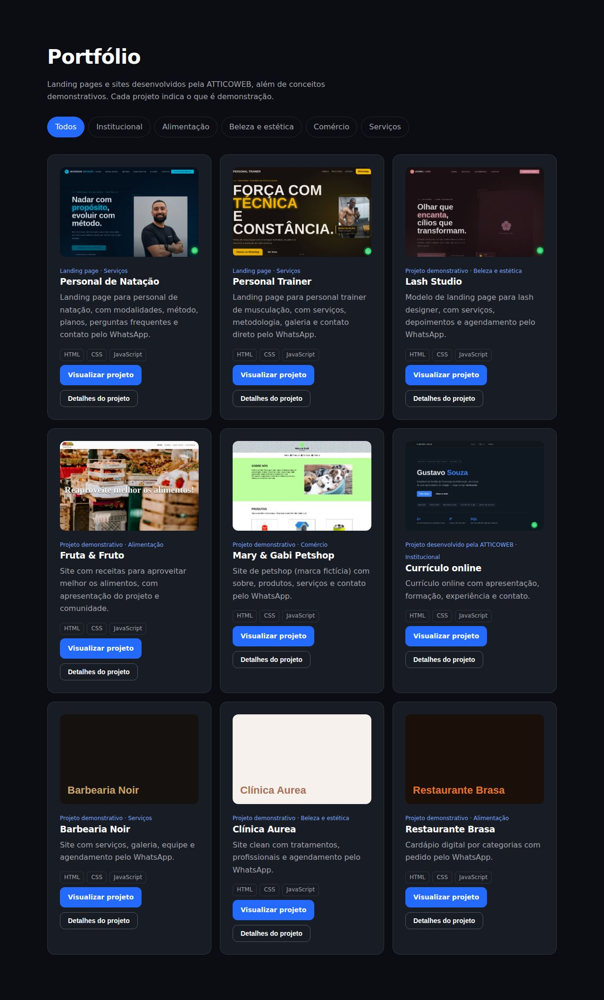

# ATTICOWEB

> Sua presença digital começa aqui.

Site institucional, portfólio comercial e vitrine de desenvolvimento web da **ATTICOWEB**, empresa de criação de sites e soluções digitais para pequenos negócios, empreendedores e profissionais autônomos.

**Demonstração online:** `https://SEU_USUARIO.github.io/NOME_DO_REPOSITORIO/` *(preencher após a publicação)*




## Sobre o projeto

O site apresenta a ATTICOWEB, seus serviços e processo de trabalho, exibe projetos desenvolvidos e leva o visitante ao contato por WhatsApp. Também funciona como demonstração pública de desenvolvimento web.

É um site estático: não tem backend, banco de dados nem etapa de build. Abre direto no navegador e publica em qualquer hospedagem estática.

## Funcionalidades

- Cabeçalho fixo com menu responsivo, navegação suave e indicação da seção ativa
- Seções de início, sobre, serviços, diferenciais, processo, planos, perguntas frequentes e contato
- Portfólio com filtros por categoria, cards com capa, tecnologias e botão de detalhes (modal)
- Páginas navegáveis para cada projeto do portfólio
- Formulário de orçamento que monta a mensagem e abre o WhatsApp (nenhum dado é armazenado ou enviado a servidor)
- FAQ em acordeão acessível (`<details>`)
- Preço, contatos e projetos centralizados em um único arquivo de configuração
- Foco visível, navegação por teclado, HTML semântico e respeito a `prefers-reduced-motion`
- Meta tags, Open Graph, favicon e `robots.txt`

## Tecnologias

HTML5, CSS3 e JavaScript puro (sem frameworks e sem dependências). Fontes Sora e DM Sans, via Google Fonts. Publicação com GitHub Actions e GitHub Pages.

## Estrutura de diretórios

```
atticoweb/
├── index.html              # Página principal
├── config.js               # Contatos, plano e lista de projetos (único arquivo a editar)
├── assets/
│   ├── style.css           # Estilos do site
│   ├── app.js              # Menu, portfólio, FAQ, formulário
│   ├── favicon.svg         # Símbolo da marca
│   └── covers/             # Capas dos projetos do portfólio
├── projects/               # Sites dos projetos, cada um em sua pasta
├── docs/                   # Imagens usadas neste README
├── .github/workflows/      # Publicação automática no GitHub Pages
├── robots.txt
└── README.md
```

## Executar localmente

Não há nada para instalar. Na pasta do projeto:

```bash
python3 -m http.server 8000
```

Abra http://localhost:8000. Também é possível abrir o `index.html` direto no navegador.

## Configurar contatos e preço

Edite apenas o `config.js`:

| Campo | O que é |
|---|---|
| `whatsapp` | DDI + DDD + número, só dígitos (ex.: `5511999999999`) |
| `instagram` | Link completo do perfil. Vazio oculta o link no rodapé |
| `email` | Endereço de e-mail. Vazio oculta o link no rodapé |
| `plan` | Preço, período, rótulo e observação do plano inicial |

## Adicionar um projeto ao portfólio

1. Coloque o site do projeto em `projects/nome-do-projeto/` (com `index.html` e caminhos relativos).
2. Salve uma captura de tela da página em `assets/covers/nome-do-projeto.jpg`.
3. Em `config.js`, copie um item da lista `projects` e ajuste:

```js
{ slug:"nome-do-projeto", name:"Nome", cat:"Serviços", filter:"Serviços",
  badge:"Landing page",                       // ou "Projeto demonstrativo"
  link:"projects/nome-do-projeto/index.html",
  cover:"assets/covers/nome-do-projeto.jpg",
  desc:"Descrição curta.", tech:["HTML","CSS","JavaScript"],
  features:["Recurso 1","Recurso 2"],
  context:"...", goal:"...", solution:"..." }
```

Categorias disponíveis nos filtros: Institucional, Alimentação, Beleza e estética, Comércio e Serviços.

Identifique corretamente cada trabalho: use `badge:"Projeto demonstrativo"` para conceitos e marcas fictícias, e só apresente como projeto de cliente o que for de cliente real e autorizado.

## Publicar no GitHub Pages

1. Crie um repositório público no GitHub e envie todos os arquivos para a branch `main`, incluindo a pasta `.github`.
2. Em **Settings > Pages**, escolha **Source: GitHub Actions**.
3. O workflow `.github/workflows/pages.yml` publica o site a cada envio. Acompanhe na aba **Actions**.
4. O endereço do site aparece em Settings > Pages. Atualize o link de demonstração no topo deste README.

Como todos os caminhos são relativos, o site funciona tanto em `usuario.github.io/repositorio/` quanto em domínio próprio.

## Melhorias futuras

- Imagem de compartilhamento (Open Graph) e `sitemap.xml` com o endereço final
- Logotipo completo e ícones para perfil e apresentações
- Novos projetos no portfólio, incluindo páginas demonstrativas com galeria e imagens próprias
- Domínio personalizado
- Novas soluções: sistemas, integrações e automações

## Licença e privacidade

Todos os direitos reservados © ATTICOWEB. O site não coleta nem armazena dados; as informações do formulário só montam a mensagem aberta no WhatsApp do visitante. Nenhuma credencial ou token está neste repositório.
